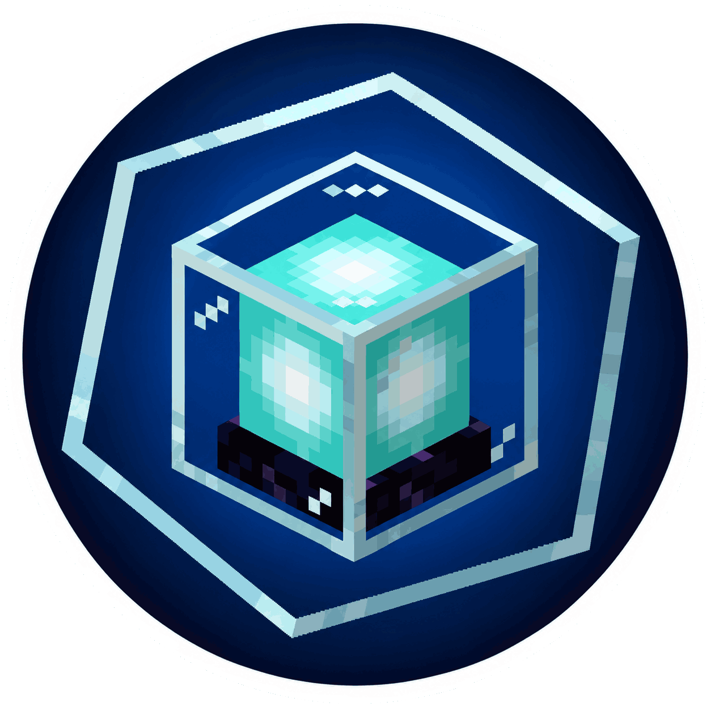
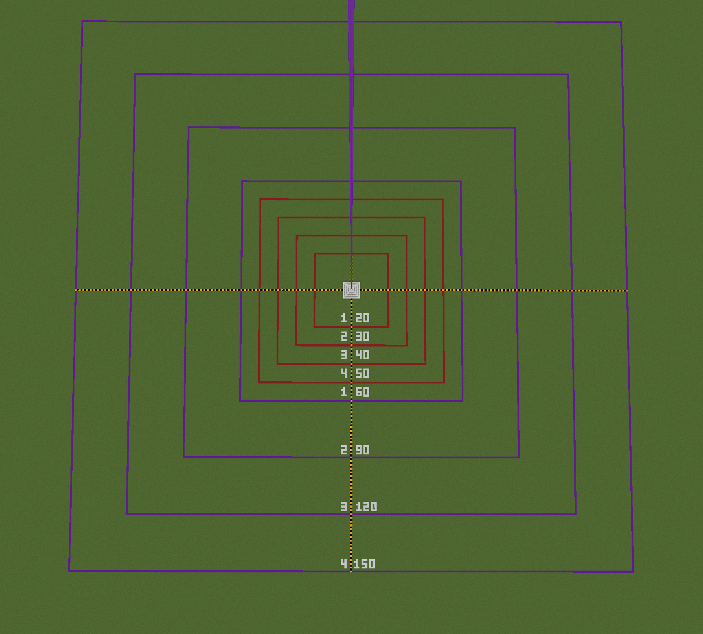
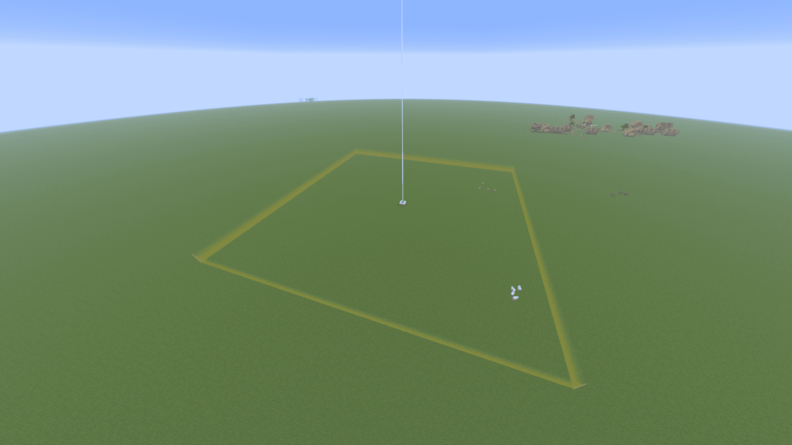
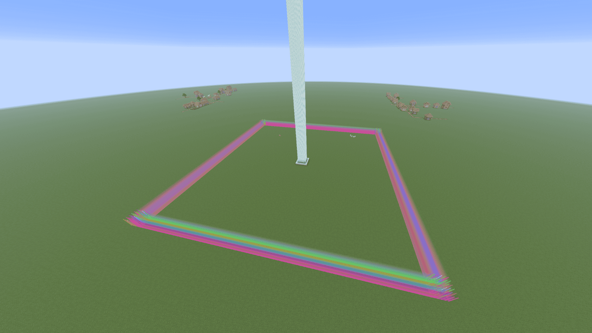
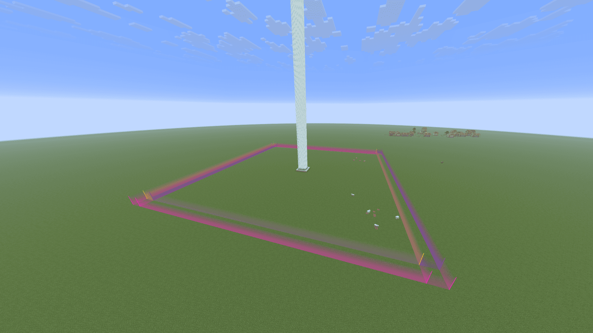
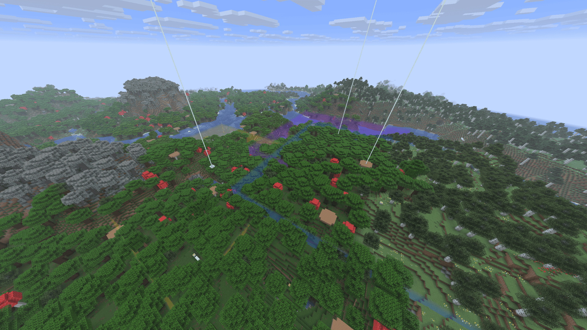
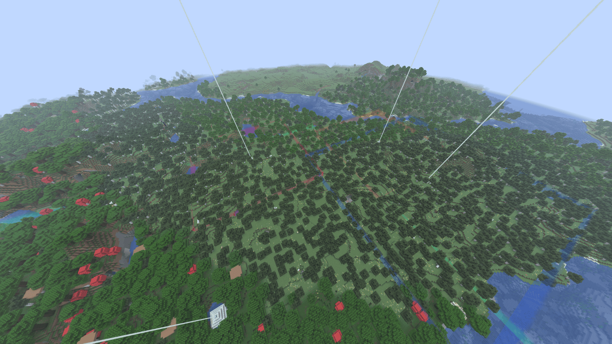

# Extended Beacon Range

[![Fabric][fabric-badge]](https://fabricmc.net/)
[![Forge][forge-badge]](https://files.minecraftforge.net/)
[![NeoForge][neoforge-badge]](https://neoforged.net/)

**Extended Beacon Range** is a lightweight quality-of-life mod that makes Beacons stronger and easier to visualize.

## ✨ Features ✨

- ✨ Beacon effect radius multiplied by **x3**
- ✨ Press **H** to toggle all Beacon perimeters
- ✨ Look at a Beacon and press **H** to toggle only that Beacon
- ✨ Multiplayer range works from the server side
- ✨ Optional client-side overlay for players who want it
- ✨ Choose colored or white perimeters from the in-game settings screen
- ✨ Translated controls, settings and messages

## 📝 Install Notes

> [!IMPORTANT]
> In multiplayer, the mod only needs to be installed on the **server** for the Beacon x3 range to work for every player.
> Players only need the mod on their **client** if they want to use the Beacon perimeter overlay with **H**.

| Setup               | What works                                                                                  |
| ------------------- | ------------------------------------------------------------------------------------------- |
| **Singleplayer**    | Range x3 and perimeter overlay both work normally.                                          |
| **Server only**     | Range x3 works for every player, even if they do not install the mod.                       |
| **Server + client** | Range x3 works, and players with the mod installed can use **H** to view Beacon perimeters. |
| **Client only**     | Shows the x3 perimeter, but beacon effects still use the server's range.                    |

The overlay shows this mod's x3 range. In multiplayer, the server must also have the mod for that range to apply.

## ⚙️ Client settings

On Minecraft **26.3**, customize your overlay with the in-game settings. Changes apply immediately and are saved automatically. Mod Menu is also supported on Fabric.

| Setting                | Default | What it does                                                                                                                         |
| ---------------------- | :-----: | ------------------------------------------------------------------------------------------------------------------------------------ |
| **Colored perimeters** |   ON    | Enables colored perimeters. Turn it off to show all perimeters in white.                                                              |
| **Match beam color**   |   OFF   | Matches the beam's top color, including stained glass mixtures. When off, colors are based on beacon position. Requires colored perimeters. |
| **Effect timers**      |   ON    | Shows the remaining time below beacon-effect icons on the HUD. The border countdown and effect levels stay visible when this is off. |

Your settings only affect your own overlay; beacon range and other players are unaffected.

The HUD shows levels and a blue border that darkens clockwise as beacon effects run out. While a loaded beacon maintains the active level, the border stays full and the timer is hidden. A weaker beacon does not hide the countdown for a stronger effect. Inventory effect panels are unchanged.

This applies to Speed, Haste, Resistance, Jump Boost, Strength and Regeneration, including those obtained from potions. Minecraft does not send the effect's source: if beacon coverage cannot be confirmed, the HUD shows the server's remaining duration. Servers with this version of the mod also announce the extended range and synchronize changes to beacon powers. Other servers use the vanilla range for HUD coverage checks; detection can be incomplete if they run an older version or change beacon behavior.

## 📏 Range Comparison

The effect radius of every Beacon pyramid level is multiplied by **x3**.

| Pyramid Level     | 🟥 Vanilla | 🟪 Extended Beacon Range | 📐 Diameter |
| ----------------- | :--------: | :----------------------: | :---------: |
| **Level 1**       |     20     |          **60**          |     121     |
| **Level 2**       |     30     |          **90**          |     181     |
| **Level 3**       |     40     |         **120**          |     241     |
| **Level 4 (Max)** |     50     |         **150**          |     301     |

> Values represent the effect radius in blocks.

## 📸 Range Visualization

🟥 **Vanilla** area **_vs_** 🟪 **Extended Beacon Range** area

<table>
   <tr>
      <td></td>
      <td></td>
      <td></td>
   </tr>
   <tr>
      <td></td>
      <td></td>
      <td></td>
   </tr>
</table>

## 🛠️ Minecraft version and loader compatibility

Version **2.1.0** targets Minecraft **26.3**. Earlier Minecraft versions use **2.0.x**. Choose your version below to find the matching download.

> [!WARNING]
> Most v1.0 files were archived because they had a multiplayer-only issue where the Beacon x3 range was not applied correctly.
> Singleplayer was not affected.
> The v1.0 file for Minecraft **26.1.2** remains available because that issue was fixed there.
> If you still need v1.x, use the links below. Other archived v1.0 files are intentionally not listed to avoid accidental downloads.

| Minecraft          | Fabric | Forge | NeoForge | \|  | Minecraft          | Fabric | Forge | NeoForge | \|  | Minecraft          | Fabric | Forge | NeoForge |
| ------------------ | :----: | :---: | :------: | :-: | ------------------ | :----: | :---: | :------: | :-: | ------------------ | :----: | :---: | :------: |
| [1.21.1][1.21.1]   |   ✅   |  ✅   |    ✅    | \|  | 1.21.2             |   ❌   |  ❌   |    ❌    | \|  | [1.21.3][1.21.3]   |   ✅   |  ✅   |    ✅    |
| [1.21.4][1.21.4]   |   ✅   |  ✅   |    ✅    | \|  | [1.21.5][1.21.5]   |   ✅   |  ✅   |    ✅    | \|  | [1.21.6][1.21.6]   |   ✅   |  ✅   |    ✅    |
| [1.21.7][1.21.7]   |   ✅   |  ✅   |    ✅    | \|  | [1.21.8][1.21.8]   |   ✅   |  ✅   |    ✅    | \|  | [1.21.9][1.21.9]   |   ✅   |  ✅   |    ✅    |
| [1.21.10][1.21.10] |   ✅   |  ✅   |    ✅    | \|  | [1.21.11][1.21.11] |   ✅   |  ✅   |    ✅    | \|  | [26.1][26.1]       |   ✅   |  ✅   |    ✅    |
| [26.1.1][26.1.1]   |   ✅   |  ✅   |    ✅    | \|  | [26.1.2][26.1.2]   |   ✅   |  ✅   |    ✅    | \|  | [26.2][26.2]       |   ✅   |  ✅   |    ✅    |
| [26.3][26.3]       |   ✅   |  ✅   |    ✅    | \|  |                    |        |       |          | \|  |                    |        |       |          |

 Made with ❤️ for the <strong>Minecraft Community</strong>

[1.21.1]: https://www.curseforge.com/minecraft/mc-mods/extended-beacon-range/files/all?version=1.21.1
[1.21.3]: https://www.curseforge.com/minecraft/mc-mods/extended-beacon-range/files/all?version=1.21.3
[1.21.4]: https://www.curseforge.com/minecraft/mc-mods/extended-beacon-range/files/all?version=1.21.4
[1.21.5]: https://www.curseforge.com/minecraft/mc-mods/extended-beacon-range/files/all?version=1.21.5
[1.21.6]: https://www.curseforge.com/minecraft/mc-mods/extended-beacon-range/files/all?version=1.21.6
[1.21.7]: https://www.curseforge.com/minecraft/mc-mods/extended-beacon-range/files/all?version=1.21.7
[1.21.8]: https://www.curseforge.com/minecraft/mc-mods/extended-beacon-range/files/all?version=1.21.8
[1.21.9]: https://www.curseforge.com/minecraft/mc-mods/extended-beacon-range/files/all?version=1.21.9
[1.21.10]: https://www.curseforge.com/minecraft/mc-mods/extended-beacon-range/files/all?version=1.21.10
[1.21.11]: https://www.curseforge.com/minecraft/mc-mods/extended-beacon-range/files/all?version=1.21.11
[26.1]: https://www.curseforge.com/minecraft/mc-mods/extended-beacon-range/files/all?version=26.1
[26.1.1]: https://www.curseforge.com/minecraft/mc-mods/extended-beacon-range/files/all?version=26.1.1
[26.1.2]: https://www.curseforge.com/minecraft/mc-mods/extended-beacon-range/files/all?version=26.1.2
[26.2]: https://www.curseforge.com/minecraft/mc-mods/extended-beacon-range/files/all?version=26.2
[26.3]: https://www.curseforge.com/minecraft/mc-mods/extended-beacon-range/files/all?version=26.3
[fabric-badge]: https://img.shields.io/badge/Fabric-C5B79B?style=for-the-badge&logo=data%3Aimage%2Fpng%3Bbase64%2CiVBORw0KGgoAAAANSUhEUgAAAEAAAABACAMAAACdt4HsAAABN2lDQ1BBZG9iZSBSR0IgKDE5OTgpAAAokZWPv0rDUBSHvxtFxaFWCOLgcCdRUGzVwYxJW4ogWKtDkq1JQ5ViEm6uf%2FoQjm4dXNx9AidHwUHxCXwDxamDQ4QMBYvf9J3fORzOAaNi152GUYbzWKt205Gu58vZF2aYAoBOmKV2q3UAECdxxBjf7wiA10277jTG%2B38yH6ZKAyNguxtlIYgK0L%2FSqQYxBMygn2oQD4CpTto1EE9AqZf7G1AKcv8ASsr1fBBfgNlzPR%2BMOcAMcl8BTB1da4Bakg7UWe9Uy6plWdLuJkEkjweZjs4zuR%2BHiUoT1dFRF8jvA2AxH2w3HblWtay99X%2F%2BPRHX82Vun0cIQCw9F1lBeKEuf1UYO5PrYsdwGQ7vYXpUZLs3cLcBC7dFtlqF8hY8Dn8AwMZP%2FfNTP8gAAAAbUExURQAAADg0KoB6bZqSfq6mlLyynMa8pdvQtOjo6H4FWGcAAAAJdFJOUwD%2F%2F%2F%2F%2F%2F%2F%2F%2F%2FzcCm9QAAAAJcEhZcwAALiMAAC4jAXilP3YAAAXiaVRYdFhNTDpjb20uYWRvYmUueG1wAAAAAAA8P3hwYWNrZXQgYmVnaW49Iu%2B7vyIgaWQ9Ilc1TTBNcENlaGlIenJlU3pOVGN6a2M5ZCI%2FPiA8eDp4bXBtZXRhIHhtbG5zOng9ImFkb2JlOm5zOm1ldGEvIiB4OnhtcHRrPSJBZG9iZSBYTVAgQ29yZSA2LjAtYzAwMiA3OS4xNjQzNTIsIDIwMjAvMDEvMzAtMTU6NTA6MzggICAgICAgICI%2BIDxyZGY6UkRGIHhtbG5zOnJkZj0iaHR0cDovL3d3dy53My5vcmcvMTk5OS8wMi8yMi1yZGYtc3ludGF4LW5zIyI%2BIDxyZGY6RGVzY3JpcHRpb24gcmRmOmFib3V0PSIiIHhtbG5zOnhtcD0iaHR0cDovL25zLmFkb2JlLmNvbS94YXAvMS4wLyIgeG1sbnM6ZGM9Imh0dHA6Ly9wdXJsLm9yZy9kYy9lbGVtZW50cy8xLjEvIiB4bWxuczpwaG90b3Nob3A9Imh0dHA6Ly9ucy5hZG9iZS5jb20vcGhvdG9zaG9wLzEuMC8iIHhtbG5zOnhtcE1NPSJodHRwOi8vbnMuYWRvYmUuY29tL3hhcC8xLjAvbW0vIiB4bWxuczpzdEV2dD0iaHR0cDovL25zLmFkb2JlLmNvbS94YXAvMS4wL3NUeXBlL1Jlc291cmNlRXZlbnQjIiB4bXA6Q3JlYXRvclRvb2w9IkFkb2JlIFBob3Rvc2hvcCAyMS4xIChXaW5kb3dzKSIgeG1wOkNyZWF0ZURhdGU9IjIwMjAtMDYtMDFUMTc6MDY6MzkrMDM6MDAiIHhtcDpNb2RpZnlEYXRlPSIyMDIwLTA2LTAxVDE3OjE4OjQ1KzAzOjAwIiB4bXA6TWV0YWRhdGFEYXRlPSIyMDIwLTA2LTAxVDE3OjE4OjQ1KzAzOjAwIiBkYzpmb3JtYXQ9ImltYWdlL3BuZyIgcGhvdG9zaG9wOkNvbG9yTW9kZT0iMiIgcGhvdG9zaG9wOklDQ1Byb2ZpbGU9IkFkb2JlIFJHQiAoMTk5OCkiIHhtcE1NOkluc3RhbmNlSUQ9InhtcC5paWQ6ZmU5ZjBmZjctMjVlZS03MzRlLWJlMzQtY2EzYjI0MWM5OWQzIiB4bXBNTTpEb2N1bWVudElEPSJ4bXAuZGlkOmUyYmU0ZDAzLTYyYmItYTc0OC1hZjYzLWYwMDQxZDUwNmZkYiIgeG1wTU06T3JpZ2luYWxEb2N1bWVudElEPSJ4bXAuZGlkOmUyYmU0ZDAzLTYyYmItYTc0OC1hZjYzLWYwMDQxZDUwNmZkYiI%2BIDx4bXBNTTpIaXN0b3J5PiA8cmRmOlNlcT4gPHJkZjpsaSBzdEV2dDphY3Rpb249ImNyZWF0ZWQiIHN0RXZ0Omluc3RhbmNlSUQ9InhtcC5paWQ6ZTJiZTRkMDMtNjJiYi1hNzQ4LWFmNjMtZjAwNDFkNTA2ZmRiIiBzdEV2dDp3aGVuPSIyMDIwLTA2LTAxVDE3OjA2OjM5KzAzOjAwIiBzdEV2dDpzb2Z0d2FyZUFnZW50PSJBZG9iZSBQaG90b3Nob3AgMjEuMSAoV2luZG93cykiLz4gPHJkZjpsaSBzdEV2dDphY3Rpb249InNhdmVkIiBzdEV2dDppbnN0YW5jZUlEPSJ4bXAuaWlkOmZlOWYwZmY3LTI1ZWUtNzM0ZS1iZTM0LWNhM2IyNDFjOTlkMyIgc3RFdnQ6d2hlbj0iMjAyMC0wNi0wMVQxNzoxODo0NSswMzowMCIgc3RFdnQ6c29mdHdhcmVBZ2VudD0iQWRvYmUgUGhvdG9zaG9wIDIxLjEgKFdpbmRvd3MpIiBzdEV2dDpjaGFuZ2VkPSIvIi8%2BIDwvcmRmOlNlcT4gPC94bXBNTTpIaXN0b3J5PiA8L3JkZjpEZXNjcmlwdGlvbj4gPC9yZGY6UkRGPiA8L3g6eG1wbWV0YT4gPD94cGFja2V0IGVuZD0iciI%2FPh7Xp9cAAADhSURBVFiF7ZbNDoQgDIS%2Forvv%2F7yEyB7kdwXZA5smxF7AFsd2MsUKQxMA34uaMcC96QPIOPwGsNAmQr8EfYAfSHylc5Yrkfol6AP0SRQ4VWgB9vi1b0nql%2FAfDgRK%2FUBBhIlPflIGCwBcSEyXGHAylY9YgqJcjuuXMJWD1D61%2BWrn4kl%2FevRL0AfYw1rpx0dPCnFUb3lW6sY91LiVznoqylpzPL%2B2lkkgydBiM%2BvHwTNk9UyK1cRNJvLghr85GegDXK71pCiBdv9NzmABgOZ8YKBoxOVJ7A%2BawKj%2BKRksAPABKYwmfSXpKIIAAAAASUVORK5CYII%3D
[forge-badge]: https://img.shields.io/badge/Forge-1B263B?style=for-the-badge&logo=data%3Aimage%2Fpng%3Bbase64%2CiVBORw0KGgoAAAANSUhEUgAAACAAAAAgCAMAAABEpIrGAAAABGdBTUEAALGPC%2FxhBQAAACBjSFJNAAB6JgAAgIQAAPoAAACA6AAAdTAAAOpgAAA6mAAAF3CculE8AAABvFBMVEUdLUEcLEEcLEAbK0AaKj4lNUguPVAuPU8vPVAnNkkoN0o5R1g3RVc0QlQ5R1lPXGuCi5ba3ODY2t7W2d3U19vS1trR1NjQ09jQ09fP09fP0tfS1dnT1tqBipUbKz8bLEA4Rlivtbzk5uji5Ofi5OadpK3d4OOxt77%2F%2F%2F%2F8%2FPz09fbq7O7h4%2BbX2t3N0dXDyM27wMa0ucChqLB9hpJkb3xDUGE7SVqyt775%2Bfq%2Fw8nw8fLKzdL%2B%2Fv7v8PKqsLhaZnQpOUsZKj6HkJrs7u%2F4%2Bfno6evX2d1hbHohMUVXY3LFyc77%2FPz5%2Bvr9%2Ff5HVGQaKj8tO052gIy9wcfa3eDo6uz19vb29%2FhmcX4ZKT4jMkYwP1E9S1xZZXTO0dYqOUwXJzxoc4C5vsQgMERqdIIxQFIZKT01Q1VncX%2Bpr7dQXWz7%2B%2Fzb3uHz9PXb3eD3%2BPjV2NtVYXA6SFrV2Nz6%2Bvqfpq%2B8wcfP0taTm6Tx8vM2RVZYZHP3%2BPnn6Ot8hZGwtr2Kkp1yfIlweoeEjZivtLuAiZT19vdTX25HVGW6vsXBxcqrsblFUmMkM0chMESco6zBxsu4vcNEUWIeLkIiMkV8HzjGAAAAAWJLR0QovbC1sgAAAAd0SU1FB%2BAJFRIdHqqGUp8AAAE8SURBVDjLY2AYBRiAkQkNgEWZmCGAiZmFlY2dnZ0NDjg4wQq4uHnAgJePX0BQSFhEVExcQlJSSkJaRlhWDigvr6CopKyioqIsoqqmrqGhqaWto6unb2BoZGxiYgq2g8nMXFMDCCwsraw1IMBGw9bO3oHFUQ7iNDkuJ2eQqJqLqw1UhZu7BwsTwvFMDJ5e3hoaPja%2BUHlhP0c0%2F%2FkHBAYFK4WEQuTDwiMwQoDJPzJKITpGD6wgNo6JAQtgYpaLT%2FAGKUhMwhGQ8vHJYAW6KalYjWBISxfRAPlDMyMzBYu0nL2gT1Z2DjBAcvO08gvk0OWZC4s0iktKQaFUVl6hIV4pj6aApapao6a2rr6hsam5RVqjtY0F3Yb2js6u7h6WiAjH3sK%2B%2FgkTMeyYNHmyBxMjxMe9kydPompKG%2FQAACylQX%2B0Y9EnAAAAJXRFWHRkYXRlOmNyZWF0ZQAyMDE2LTA5LTIxVDE4OjI5OjMwKzAyOjAw62z2vAAAACV0RVh0ZGF0ZTptb2RpZnkAMjAxNi0wOS0yMVQxODoyOTozMCswMjowMJoxTgAAAAAZdEVYdFNvZnR3YXJlAEFkb2JlIEltYWdlUmVhZHlxyWU8AAAAV3pUWHRSYXcgcHJvZmlsZSB0eXBlIGlwdGMAAHic4%2FIMCHFWKCjKT8vMSeVSAAMjCy5jCxMjE0uTFAMTIESANMNkAyOzVCDL2NTIxMzEHMQHy4BIoEouAOoXEXTyQjWVAAAAAElFTkSuQmCC
[neoforge-badge]: https://img.shields.io/badge/NeoForge-D7722C?style=for-the-badge&logo=data%3Aimage%2Fpng%3Bbase64%2CiVBORw0KGgoAAAANSUhEUgAAAIAAAACACAYAAADDPmHLAAAACXBIWXMAAAsSAAALEgHS3X78AAADgklEQVR42u2dPWhTYRSGk2qlZKia%2BBMNFuJQERehuFiogoNSJ7tIi4MKFkELInapVYOIS8SlCqKoiwji5OhStLQOlUz%2BYUFrC2li7I26hGCwEbXrOTec5OKN93nWw%2F363S8PJ7w9yU0oBAAAASWsFdPXb1Q5ouZn%2BOxp8XVu4XiCDQIgACAAIAAgAASQlVrU6%2B07aFp0bTTqq5v8WiwG%2FXWu0gEAAQABAAEAAQABYDkGWuPc5PiEWIttXCfWIpGIebP3L4%2Barjt28YpYK5VKYu3Rtaumv3f43IgnL5bzedF05nQAQABAAEAAQABAAKgxBr5781asbUl2mKKVVnOLXts6EmLt%2FXzWdADWWKrtRbuHeiKiNerRAQABAAEAAQABAAGgxhgY3xQXa%2Flc3hSt3CZ6WrwaOHlKrF0akePVhwuDttNp3WDay8NbN00RsZ6YqE0K6QCAAIAAgACAAIAAgABQy%2F8BtKyvoY18eyoF9dqJebn2aXrBtG4i9tN0Hz1OwbQXbTTtdv9WtFHx3Mc5OgAgACAAIAAgACAA1BID%2FwX97TmxVh4%2FL9a6OitibXW8zbSXeL4sR2RlL%2F3t8ppZZ4Un58Y4GBAAEAAQABAAEAB8GgPdJnPxWKUpDs6rfS7RAQABAAEAAQABAAGg%2BWJgy%2B0hc3zampoSa8XsrFj7dueIaa%2FflYmfxpoTD8RaNJGUL0x1q%2BvmlbNbGhyjAwACAAIAAgACAAJAvTGwkFts%2BKJaXNFizp8YqNT2HDoq1p70Nj7qhYx7eTX9XL5%2Fp1Vdt%2B3MXdN%2BHKWmvcZ0AN4CAAEAAQABAAEgcDHQeqH2XbQf9%2BQfatS%2Bw%2FcbbeLnfMkpV643Ry8JbXKp7UW7B7dpaEZ5rO2q46N0AEAAQABAAEAAQACok%2FDwcKoqFQ%2F07TfFQA0tIv6NieX%2F%2BsAzM%2FrjaryIei%2BnMnQAQABAAEAAQABAAFjGd08KtU7udo89E2ubk52mNRdmZ8Tai6G9dABAAEAAQABAAEAAQADg%2FwAuuI07sy7jYguvJ582fE3rL394Me6lAwACAAIAAgACAAJAg2Kg9slf7ZOmu7q7PIuJEo8H9vkqznqBF2dOB%2BAtABAAEAAQABAAiIE1smPndl%2FdiN%2BmbF7gxZnTAXgLAAQABAAEAASAoBHWitrzg6B5SKdTYToAIAAgACAAIAAgAAAAAECQ%2BQUUBtshXi5agwAAAABJRU5ErkJggg%3D%3D
